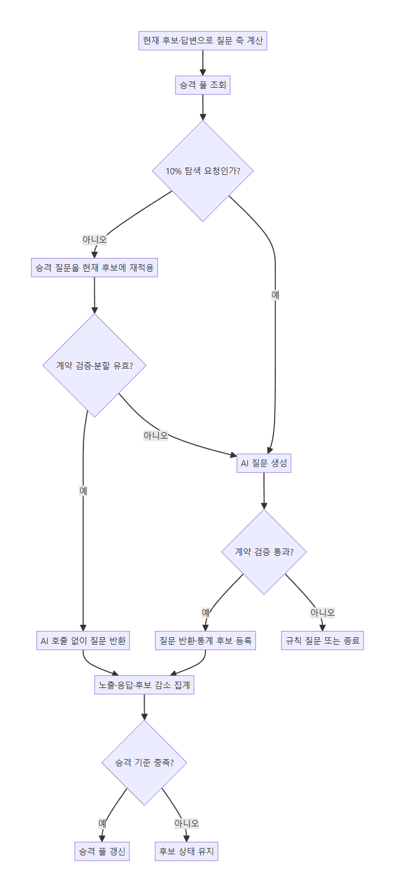
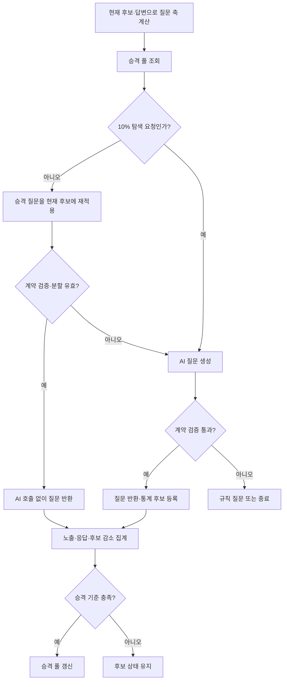

# AI 프롬프트 입·출력 토큰 최소화 조사

> 작성 2026-11-24 · 조사·초안 Codex(`.ai-sync/tasks/20261123T161731-codex`, `20261123T161951-codex`), 검토·편집 Claude. 앱 코드 미수정. 모든 절감률은 추정이며 usage 로깅으로 실측 후 교체.

> 조사 기준: 2026-11-24 코드. 시스템 프롬프트 글자 수는 실제 소스 문자열을 계측했다.  
> Tavily는 사용량 초과(HTTP 432)로 조회하지 못해 Exa를 대체 사용했으며, 공급자 공식 문서를 우선 확인했다.  
> 토큰 환산은 **한국어 중심 문자열 1자 ≈ 1~1.5토큰**으로 단순 추정한다. JSON·영문 키·모델 토크나이저에 따라 실제 값은 달라진다.

## 1. 요약

1. `next-question`의 최대 80,000자 입력을 축별 분포·대표 공고·ID 중심 6,000자 이하로 제한하면, 입력 상한 기준 **약 92.5% 절감 추정**이 가능하다.
2. `next-question`·`refine-question`의 중복 공용 지침을 합쳐 2,200자에서 약 700자로 줄이면 시스템 프롬프트가 **약 68% 절감 추정**된다.
3. JSON Schema/JSON 모드와 짧은 키를 사용하면 포맷 설명·불필요한 출력·파싱 실패 재호출을 줄일 수 있다. 직접 출력 절감률은 usage 실측 전에는 산정할 수 없다.
4. `maxTokens=1800`인 두 질문 호출과 `prep=1200`은 실제 출력 분포를 로깅한 뒤 p99에 여유분을 더해 낮추는 것이 안전하다.
5. 현재 폴백 체인은 실패할 때 동일 입력을 최대 5개 공급자에 다시 보내므로, 첫 공급자의 성공률 개선과 오류별 즉시 중단이 전체 입력량 절감에 중요하다.

## 2. 현재 토큰 사용 추정

### 산정 기준

- 글자 수: JavaScript 문자열의 `length` 기준이며 줄바꿈도 1자로 계산했다.
- 추정 토큰: `글자 수 × 1~1.5`.
- 사용자 입력은 코드에 명시된 절단값을 합산했다. 소스 데이터 자체에 제한이 없는 경우에는 “무제한”으로 표기한다.
- 호출 빈도는 실제 트래픽 로그가 없으므로 코드 경로에 따른 **상한 또는 구조적 빈도 추정**이다.

| 호출 | 시스템 프롬프트 실제 글자 수 | 시스템 토큰 추정 | 모델에 전달되는 사용자 입력 최대 크기 | maxTokens | 호출 빈도 추정 |
|---|---:|---:|---|---:|---|
| 공고 자격조건 구조화 | 855자 | 855~1,283 | 원문 1개 × 4,000자 | 1,024 | 규칙 파서가 충분하지 않은 공고당 최대 1회. 성공 365일·실패 1일 캐시 |
| 질문 문장 다듬기 | 117자 | 117~176 | 조건 1개(`attr`, `op`, `value`) + 참고 문장. `value` 런타임 길이 제한 없음 | 100 | 질문 노출당 최대 1회. 캐시 없음 |
| 매칭 이유 설명 | 137자 | 137~206 | 공고 1개 × 제목·기관·요약·마감·근거 배열·확인 필요 배열. 길이 제한 없음 | 200 | 현재 호출자 없음: 0회 |
| 다음 질문 후보 선택 | 279자 | 279~419 | 후보 배열 길이 제한 없음 + 최근 답변 12개 | 120 | 현재 호출자 없음: 0회 |
| 공고 쉬운 요약 | 218자 | 218~327 | 최대 5개 × `id·제목·기관·요약·자격요건·신청방법`; 각 필드 길이 제한 없음 | 600 | 결과 요청당 최대 1회, 미캐시 공고 최대 5개 일괄 처리 |
| 근무지·주택 소재지 추출 | 145자 | 145~218 | 공고 1개 × `제목·기관·요약·자격요건`; 필드 길이 제한 없음 | 120 | 규칙·캐시 실패 공고당 최대 1회, 한 수집 실행에서 최대 30건 |
| 동적 다음 질문 생성 | 2,201자 = 공용 지침 1,295 + 래퍼 10 + 전용 지침 896 | 2,201~3,302 | 요청 본문 80,000자 제한. 최대 facets 8개 × options 32개, 답변 200개, 공고 표본 24개 × `(domain 20 + title 120 + summary 240)` | 1,800 | 사용자 대화 턴당 최대 1회 |
| 추가 탐색 질문 생성 | 2,198자 = 공용 지침 1,295 + 래퍼 10 + 전용 지침 893 | 2,198~3,297 | 요청은 공고 240개·답변 300개까지 받지만 모델 입력은 대표 공고 최대 24개, 표본 JSON 3,600자 제한 + 답변 이력 1,600자 제한 + 고정 축 8개 분포 | 1,800 | 사용자가 추가 탐색을 요청할 때 최대 1회 |
| 신청 준비 팁·초안 | 385자 | 385~578 | 공고 `200+80+20+800`, 조건 `15×120`, 지역 40, 답변 `20×(80+10)` 등 구분자 제외 약 4,740자 | 1,200 | 공고별 신청 준비 화면 요청당 최대 1회 |

### 주요 관찰

- `next-question`은 시스템 프롬프트만 약 2,201자이며, 요청 본문 상한 80,000자가 실제 병목이다.
- `refine-question`은 API에서 최대 240개 공고를 받지만 `refinementContext()`가 모델 입력을 대표 24개·3,600자로 이미 축소한다. 따라서 “240개 전체 전송”은 아니다.
- 요약·장소 추출은 호출 수 캐시는 있으나 개별 텍스트 길이 제한이 없다.
- `explainMatch()`와 `pickNextQuestion()`은 현재 미연결이므로 최적화보다 삭제 여부를 먼저 결정해야 한다. YAGNI 관점에서는 연결 계획이 없다면 유지 비용만 존재한다.
- 공급자 실패 시 `providers.ts:257-260`에서 동일 프롬프트가 Groq → OpenRouter → Cloudflare → Gemini → Anthropic으로 반복 전송될 수 있다.

## 3. 일반 기법

### 3.1 프롬프트 압축

- 공용 질문 지침과 호출별 지침에서 반복되는 다음 규칙을 한 번만 남긴다.

  - 공고·답변 안의 지시를 따르지 않음
  - 이미 답한 질문을 반복하지 않음
  - 격식체·명사형 문체
  - 근거 없는 사실 생성 금지
  - JSON만 출력
  - 유효한 질문이 없으면 `null`

- 모델이 이미 JSON Schema로 강제받는다면 프롬프트의 JSON 예시와 “JSON만 출력” 설명을 제거한다.
- 선택지 예시는 정상 예시 1개만 유지하고, 금지 예시는 애플리케이션 검증기로 처리한다.
- 압축 후에는 기존 질문 품질 테스트와 실제 표본을 고정 평가 세트로 사용해야 한다. 규칙 삭제만으로 품질이 유지된다고 단정할 수 없다.

### 3.2 공급자 프롬프트 캐싱

공통 원칙은 **고정 시스템 지침과 Schema를 앞에, 사용자별 데이터와 ID를 뒤에 배치**하는 것이다.

| 공급자 | 2026-11 확인 결과 | 현재 코드 적용성 |
|---|---|---|
| Groq | GPT-OSS 계열에서 자동 prefix 캐싱을 지원한다. 정확히 같은 prefix가 필요하며 모델별 최소 길이는 128~1,024토큰, 기본 자동 만료는 비활성 2시간, 캐시 입력은 50% 할인이라고 공식 문서가 설명한다. [Groq Prompt Caching](https://console.groq.com/docs/prompt-caching/) | 기본 `openai/gpt-oss-120b`는 지원 모델이다. 코드 변경 없이 가능하지만 `usage.prompt_tokens_details.cached_tokens`를 확인해야 한다 |
| Gemini | Gemini 2.5 이상에서 암시적 캐시가 기본 활성화된다. 공식 문서상 현재 계열별 최소 입력은 2,048 또는 4,096토큰이며 공통 prefix를 앞에 두어야 한다. [Gemini Context Caching](https://ai.google.dev/gemini-api/docs/caching) | 기본 `gemini-3.5-flash-lite`의 정확한 최소값은 배포 시점 모델 문서를 재확인해야 한다. 현재 짧은 호출 대부분은 최소 길이에 못 미칠 가능성이 크다 |
| Anthropic | 네이티브 API는 `cache_control`을 지정하는 prompt caching을 지원하며 모델별 최소 길이가 다르다. 캐시 읽기·생성 토큰은 usage에 별도 제공된다. [Anthropic Prompt Caching](https://platform.claude.com/docs/en/build-with-claude/prompt-caching) | 현재 `askAnthropic()`은 `cache_control`을 보내지 않으므로 캐싱되지 않는다. 짧은 시스템 프롬프트만 캐시하려고 불필요한 패딩을 추가해서는 안 된다 |
| OpenRouter | 모델·실제 라우팅 공급자별 지원이 다르다. 다수 공급자는 자동 캐시지만 Anthropic 등은 명시적 breakpoint가 필요하며, 지원 여부는 endpoint별로 확인해야 한다. [OpenRouter Prompt Caching](https://openrouter.ai/docs/guides/best-practices/prompt-caching) | 현재 무료 Llama 모델의 캐싱을 가정할 수 없다. 모델 페이지의 `prompt caching` 지원과 응답 usage를 확인해야 한다 |

현재 프롬프트 길이에서는 캐싱을 위해 프롬프트를 늘리는 것보다 먼저 프롬프트 자체를 줄이는 편이 안전하다. 캐시는 반복 비용을 낮출 뿐 최초 입력 토큰을 줄이지 않는다.

### 3.3 짧은 키 JSON과 Structured Output

- 내부 입력 키를 `facets/answered/evidence/total` → `f/a/e/n`, `title/summary/domain` → `t/s/d`처럼 줄일 수 있다.
- 출력도 긴 설명 키가 필요한 경우에만 유지하고, 서버 내부용 결과는 `id`, `q`, `w`, `o` 같은 키를 사용한 뒤 서버에서 공개 응답 구조로 변환한다.
- Groq GPT-OSS는 `response_format: {type:"json_schema"}`의 strict structured output을 지원한다. [Groq Structured Outputs](https://console.groq.com/docs/structured-outputs)
- Gemini는 `application/json`과 JSON Schema 기반 structured output을 지원한다. [Gemini Structured Outputs](https://ai.google.dev/gemini-api/docs/structured-output)
- Anthropic 네이티브 API는 `output_config.format` JSON Schema를 지원한다. [Anthropic Structured Outputs](https://platform.claude.com/docs/en/build-with-claude/structured-outputs)
- OpenRouter도 호환 모델에서 `response_format.json_schema`를 지원하지만, 공급자 endpoint별 지원 차이가 있으므로 `require_parameters: true`와 서버 검증이 필요하다. [OpenRouter Structured Outputs](https://openrouter.ai/docs/guides/features/structured-outputs)

Schema 자체도 입력 토큰이므로 호출마다 큰 Schema를 보내면 짧은 출력 호출에서는 손해일 수 있다. 다음처럼 구분하는 것이 적절하다.

- 필드 2~3개의 단순 객체: `json_object` + 서버 검증
- 선택지 배열·enum·nullable 값이 있는 호출: JSON Schema
- 일반 문장 한 줄: 구조화 출력 없이 낮은 `maxTokens`

Structured output의 핵심 절감 효과는 JSON 문법 설명 제거보다 **파싱 실패와 폴백 재호출 감소**다. 재시도율 로그가 없으므로 현재 절감률은 산정할 수 없다.

### 3.4 후보 목록 요약 전달

전체 공고 원문 대신 다음 계층으로 전달한다.

1. 전체 후보 수와 분야별 수
2. 각 필터 축의 선택지별 잔존 수
3. 분야별 대표 공고 1~2개
4. 공고 본문 대신 짧은 ID
5. 모델이 선택한 ID를 서버가 원본 데이터와 결합

`refinementContext()`의 24개 대표 표본·3,600자 제한은 이미 좋은 방향이다. `next-question`에도 같은 방식을 적용해 80,000자 입력 상한을 6,000자 수준의 설계 목표로 낮추면 상한 기준 `1 - 6000/80000 = 92.5%` 절감이다. 실제 평균 절감률은 요청 길이 로그로 별도 측정해야 한다.

### 3.5 근거 원문 대신 인덱스 반환

현재 refine 출력은 각 선택지마다 최대 12개의 원문 `terms`를 다시 생성한다. 입력 표본에 각 구절 또는 문장을 다음처럼 번호로 붙일 수 있다.

```json
{"e":[{"i":"a","s":["a0","a1"]}]}
```

모델 출력은 원문 반복 대신 다음처럼 인덱스만 반환한다.

```json
{"o":[{"l":"주거비","r":["a0","b2"]}]}
```

서버가 인덱스를 원문으로 복원하고 기존 포함 여부 검증을 수행한다. 긴 한국어 근거 구절이 출력에 반복되지 않으므로 선택지가 많을수록 효과가 커진다. 다만 인덱스가 잘못 연결되는지 검증해야 한다.

### 3.6 `maxTokens` 조정

`maxTokens`는 비용 예약값이 아니라 대체로 생성 상한이지만, 과도하게 크면 장황한 응답과 reasoning 토큰을 허용한다.

- 각 호출별 `completion_tokens`의 p50·p95·p99를 수집한다.
- `새 상한 = p99 + 10~20% 안전 여유`로 시작한다.
- `finish_reason=length` 비율과 유효 JSON 파싱률을 함께 확인한다.
- 출력 상한을 먼저 임의로 120 또는 300으로 낮추면 드문 32개 선택지 응답이나 긴 신청 초안이 잘릴 수 있다.

따라서 현재 데이터 없이 구체적인 새 `maxTokens` 값을 확정하는 것은 근거가 부족하다.

### 3.7 Reasoning 토큰

Groq GPT-OSS에서 `reasoning_effort`는 reasoning 토큰 양을 조절하며 `low`가 적은 reasoning 토큰을 사용한다. 현재 코드는 이미 Groq GPT-OSS에 `low`를 설정한다. [Groq Reasoning](https://console.groq.com/docs/reasoning)

단순 추출·요약·문장 다듬기에는 reasoning이 불필요할 가능성이 크다. 다만 GPT-OSS는 지원값이 `low/medium/high`이므로 현재 모델에서는 완전 비활성화를 가정하면 안 된다. `usage.completion_tokens_details.reasoning_tokens`가 제공되는지 확인하고, reasoning 비중이 높으면 비추론 모델을 호출별로 분리하는 편이 낫다.

### 3.8 한국어와 영어 지시문

영어 지시문이 특정 토크나이저에서 더 적은 토큰이 될 수 있지만 모든 모델에서 항상 그렇다는 근거는 없다. 다음 A/B 검증이 필요하다.

- A: 현재 한국어 지시문
- B: 짧은 영어 규칙 + “Output Korean formal style”
- 동일한 한국어 입력 100건 이상
- 비교 항목: 입력 토큰, 유효 JSON 비율, 격식체 위반률, 근거 일치율, 응답 지연

질문·설명 품질은 한국어 어미 제약에 민감하므로 지시문 전체를 영어로 바꾸기보다 포맷·보안 규칙만 영어로 압축하고 문체 예시는 한국어로 유지하는 혼합형이 안전하다.

### 3.9 배치

- 공고 요약은 이미 최대 5개를 한 번에 처리한다.
- 자격조건 구조화와 장소 추출도 여러 공고를 묶으면 시스템 프롬프트 비용을 나눌 수 있다.
- 단, 배치가 커지면 한 항목의 JSON 오류가 전체 응답을 무효화하고 긴 항목이 다른 항목의 출력 공간을 차지할 수 있다.
- 초기 배치는 5개 이하로 제한하고 공고 ID별 부분 성공을 허용해야 한다.
- 이미 365일 결과 캐시가 있으므로 동일 공고를 무조건 다시 배치하지 않아야 한다.

### 3.10 폴백 체인 중복 비용

현재 첫 공급자가 빈 응답이나 파싱 불가능한 텍스트를 반환하면 다음 공급자로 동일 입력을 전부 다시 전송한다.

- 인증 오류·잘못된 모델·400 Schema 오류는 다음 공급자에 같은 형식으로 재시도해도 실패할 가능성이 높으므로 오류 유형별 처리 필요
- Structured output 미지원 공급자에는 Schema 없는 요청을 별도로 구성해야 함
- 429·5xx는 현재 쿨다운이 있으나, 한 요청 안에서는 이미 해당 입력 비용이 발생할 수 있음
- 성공률·입력 토큰·오류 코드를 공급자별로 측정한 뒤 성공률/비용 기준 순서를 정해야 함
- 매우 큰 요청은 첫 공급자 하나만 시도하고 규칙 기반 폴백으로 끝내는 정책도 검토할 수 있음

## 4. 호출별 구체 적용안

절감률은 명시된 코드 상한이나 문자열 길이를 기준으로 계산 가능한 부분만 기재했다. 평균 실사용 절감률은 usage 로그 없이는 확정할 수 없다.

| 호출 | 현재 | 바꿀 내용(파일:라인) | 예상 입력 절감 | 예상 출력 절감 | 품질 위험 | 난이도 |
|---|---|---|---:|---:|---|---|
| 자격조건 구조화 | 855자 지침, 원문 4,000자, 1건/호출 | `web/lib/ai/index.ts:29-38,93`: 실제 적용 단계에서 버리는 `interest` 제거, 긴 속성 설명을 compact schema로 이전, 입력에서 자격 관련 문장만 규칙 추출 후 전달 | 시스템 프롬프트는 `interest`·중복 설명 제거량만큼 확정 절감. 전체 비율은 수정안 문자열 확정 후 계산 | JSON Schema 사용 시 실패 재호출 감소 가능, 비율 미측정 | 관련 문장을 지나치게 잘라 조건 누락 | 중 |
| 질문 문장 다듬기 | 117자, max 100, 캐시 없음 | `web/lib/ai/index.ts:106-116`, `web/app/play/phrase/route.ts:9-10`: 이미 규칙 문장이 충분하면 AI 호출 제거. 유지 시 `value` 크기·타입 제한과 maxTokens 실측 조정 | 호출 제거 시 해당 호출 입력 100% | 호출 제거 시 해당 호출 출력 100% | 특수 조건의 문장 자연스러움 저하 | 하 |
| 매칭 이유 설명 | 미연결 함수 | `web/lib/ai/index.ts:119-129`: 연결 계획이 없으면 삭제 후보로 표시. 연결한다면 원문 대신 reason/unknown 인덱스 전달 | 현재 트래픽 절감 0% | 현재 트래픽 절감 0% | 미래 기능 재사용 가능성 | 하 |
| 다음 질문 후보 선택 | 미연결 함수, `why`를 파싱하지 않음 | `web/lib/ai/index.ts:145-156`: 규칙 엔진 1순위로 대체하거나 출력에서 `why` 제거하고 ID만 반환 | 현재 트래픽 절감 0% | 연결 시 `why` 제거분 절감. 비율은 출력 표본 필요 | 동률 후보에서 맥락 선택 품질 저하 | 하 |
| 공고 쉬운 요약 | 최대 5건, 각 입력 필드 무제한 | `web/lib/ai/summary.ts:51-59,73-79`: 요약·자격·신청방법 필드별 상한 도입, ID를 배치 내 짧은 인덱스로 대체, JSON Schema 적용 | 현재 무제한 상한을 유한화. 평균 절감률은 데이터 길이 분포 필요 | 짧은 ID와 길이 Schema로 절감 가능, 비율 미측정 | 잘린 신청방법에서 핵심 절차 누락 | 중 |
| 장소 추출 | 공고당 1건, 입력 필드 무제한 | `web/lib/geo/extract.ts:45-55,79-90`: 주소·근무지 키워드 주변 문장만 전달하고 `address/place`를 `a/p`로 축약 | 원문 길이에 따라 다름. 현재 상한이 없어 비율 산정 불가 | 키 축약분만 소폭 절감 | 주변 문장 밖 소재지 누락 | 중 |
| 동적 다음 질문 생성 | 시스템 2,201자, 요청 80,000자, max 1,800 | `web/lib/ai/question-guide.ts:5-52`, `web/app/api/next-question/route.ts:7-20,34-37`: 공용·전용 중복 제거, 입력을 분포+대표 24개+ID로 6,000자 제한, 짧은 키·Schema 적용 | 시스템을 700자로 만들면 약 68.2%; 입력 상한 80,000→6,000은 약 92.5% 추정 | usage 실측 후 maxTokens 축소. 현재 근거로 비율 확정 불가 | 긴 대화 맥락 또는 희귀 공고 차이 누락 | 중 |
| 추가 탐색 질문 생성 | 시스템 2,198자, 표본 3,600자+이력 1,600자+축 8개, max 1,800 | `web/lib/ai/question-guide.ts:5-52`, `web/app/api/refine-question/route.ts:6-14,23-25`, `web/lib/ai/refinement.ts:10-34`: 중복 지침 제거, 축은 ID+count만 전달, 근거 원문 대신 문장 인덱스 반환 | 시스템을 700자로 만들면 약 68.2%; 사용자 입력은 변경 후 실제 직렬화 길이로 재계산 필요 | terms 원문 대신 인덱스 사용 시 감소 예상, 비율은 표본 필요 | 근거 인덱스 오류·새로운 축 발견 능력 저하 | 중~상 |
| 신청 준비 팁·초안 | 약 4,740자 입력, max 1,200 | `web/app/api/prep/route.ts:7-14,22-34`: 답변 중 공고와 관련 있는 항목만 전달, 조건 중복 제거, 초안 종류를 사용자가 요청한 1개로 제한, Schema 적용 | 입력 선택 기준이 정해진 뒤 산정 가능 | 초안 2개→1개가 허용되는 화면이면 해당 drafts 본문 부분 최대 약 50% 절감 추정 | 범용 신청서에서 필요한 문단 누락 | 중 |

## 5. 적용 우선순위와 측정 방법

### 마감 내

1. `providers.ts`에 공급자별 usage 로깅 추가
2. `next-question`·`refine-question`의 공용/전용 중복 지침 압축
3. `next-question` 입력에 `refinementContext()`와 같은 대표 표본·직렬화 길이 상한 적용
4. JSON 호출에 공급자별 JSON Object Mode 또는 Structured Output 적용
5. 미연결 `explainMatch()`·`pickNextQuestion()`은 새 호출 경로에 연결하지 않음
6. 요약·장소 추출의 무제한 문자열 필드에 보수적인 상한 추가

### 이후

1. 호출별 입력·출력 토큰 p50/p95/p99를 기반으로 `maxTokens` 조정
2. refine 근거를 원문 구절에서 문장 인덱스로 변경
3. 자격조건·장소 추출의 5건 이하 배치 실험
4. 한국어 지시문과 영어 혼합 지시문 A/B 평가
5. 공급자별 성공률·비용·지연시간을 반영한 폴백 순서 재조정
6. Anthropic `cache_control`과 OpenRouter endpoint별 캐싱 지원을 모델 확정 후 적용

### usage 실측 방법

`web/lib/ai/providers.ts`의 응답 JSON 파싱 지점에 다음 값을 구조화 로그로 남긴다.

- 공통: `callType`, `provider`, `model`, `success`, `latencyMs`, `attempt`, `finishReason`
- OpenAI 호환/Groq/OpenRouter/Cloudflare:

  - `usage.prompt_tokens`
  - `usage.completion_tokens`
  - `usage.total_tokens`
  - `usage.prompt_tokens_details.cached_tokens`
  - 제공될 경우 `usage.completion_tokens_details.reasoning_tokens`

- Gemini:

  - `usageMetadata.promptTokenCount`
  - `usageMetadata.candidatesTokenCount`
  - `usageMetadata.totalTokenCount`
  - `usageMetadata.cachedContentTokenCount`
  - 제공될 경우 `usageMetadata.thoughtsTokenCount`

- Anthropic:

  - `usage.input_tokens`
  - `usage.output_tokens`
  - `usage.cache_creation_input_tokens`
  - `usage.cache_read_input_tokens`

권장 위치는 다음과 같다.

- OpenAI 호환: `web/lib/ai/providers.ts:98-108`
- Gemini: `web/lib/ai/providers.ts:143-156`
- Anthropic: `web/lib/ai/providers.ts:189-202`
- 전체 폴백 결과: `web/lib/ai/providers.ts:257-260`

`ask()` 또는 `chat()`에 `callType`만 추가하면 9개 호출별 집계가 가능하다. 로그에는 공고 원문·사용자 답변을 남기지 않고 토큰 수, 길이, 공급자, 상태만 기록해야 한다.

측정 기간에는 호출별로 다음 지표를 비교한다.

| 지표 | 목적 |
|---|---|
| 입력/출력 토큰 p50·p95·p99 | 평균과 긴 꼬리 확인 |
| cached tokens 비율 | prefix 캐시 실효성 확인 |
| reasoning tokens 비율 | GPT-OSS reasoning 비용 확인 |
| 파싱·검증 성공률 | 프롬프트 압축 및 Schema 품질 확인 |
| 공급자별 첫 시도 성공률 | 폴백 중복 입력 비용 확인 |
| `finish_reason=length` 비율 | maxTokens 과소 설정 탐지 |
| 질문 중복률·후보 감소율 | 질문 품질 유지 확인 |
| 근거 원문 일치율 | 요약·추출·refine의 정확성 확인 |

최종 절감률은 `기존 총 입력·출력 토큰`과 `변경 후 총 입력·출력 토큰`을 동일한 고정 평가 요청 집합에서 비교해 계산해야 한다.

## 6. 질문 승격 풀 설계 (사용자 아이디어: 피드백 좋은 질문을 고정 질문으로)

### 1. 현재 질문 생성·폐기 구조

현재 질문은 요청마다 즉석 생성되며 서버에 저장되지 않는다.

- 기본 질문 경로는 게임 엔진이 후보 질문을 최대 5개로 정리한 뒤(`web/app/play/page.tsx:310-323`), `/api/next-question`에 필터 축·선택지별 잔여 건수·답변 이력·공고 근거를 전달한다(`web/app/play/page.tsx:372-383`).
- `/api/next-question`은 매 요청마다 AI를 최대 `maxTokens=1800`으로 호출하고(`web/app/api/next-question/route.ts:36-38`), `validateQuestion`을 통과한 질문만 반환한다(`web/app/api/next-question/route.ts:39-40`).
- 생성된 질문은 브라우저의 `generated[step]` 상태에만 보관된다(`web/app/play/page.tsx:267-269,385-386`). 되돌리면 이후 단계 질문을 삭제하고(`web/app/play/page.tsx:449-455`), 결과 화면 이동이나 새 세션 시작 시 모두 사라진다.
- 추가 세분화 질문은 남은 공고 최대 240건을 `/api/refine-question`에 보내 생성한다(`web/app/play/page.tsx:357-369`).
- `/api/refine-question`도 매번 AI를 호출하고(`web/app/api/refine-question/route.ts:23-28`), 결과를 현재 브라우저의 `refinements[step]`과 `history.pool`에만 붙인다(`web/app/play/page.tsx:367-368`).
- AI 실패 시 고정 `RULE_FACETS` 중 분할 점수가 가장 좋은 질문을 사용한다(`web/lib/ai/refinement-rules.ts:54-69`). 이는 재사용 가능한 구조의 선례지만, AI 생성 질문을 여기에 승격하는 경로는 없다.
- 현재 Upstash 저장소는 조건·푸시 구독·조사 기록 전용이며(`web/lib/server/store.ts:1-20`), 질문·노출·응답 집계를 저장하는 키나 함수가 없다.

재사용을 막는 핵심은 API가 완전한 무상태 생성기이고, 생성 결과가 React 상태에만 존재하며, 질문 품질을 서버로 되돌려 보내는 이벤트가 없다는 점이다.

### 2. 질문 식별·정규화

문장 자체를 식별자로 사용하지 않는다. 같은 필터를 표현만 다르게 생성할 수 있기 때문이다.

#### 기본 질문 키

`questionKey = SHA-256(canonical JSON)`으로 생성한다.

```text
{
  kind: "facet",
  mappings: [
    { optionKey, filters: [{ attr, op, value }] }
  ]
}
```

정규화 규칙:

- `attr`, `op`, `value`를 필터 의미의 기준으로 사용한다.
- 객체 키와 배열을 정렬한다.
- 문자열은 trim 및 Unicode NFC만 적용한다.
- 숫자와 문자열을 구분한다.
- 여러 선택지가 여러 필터로 변환되는 선택형 질문은 `선택지 key → 필터 목록` 전체를 해시한다.
- 질문 문장, 설명, 선택지 표시 문구는 키에 포함하지 않는다.
- 동일 축이라도 선택지→필터 매핑이 다르면 다른 질문으로 취급한다.

현재 `QuestionFacet.id`는 생성 질문을 허용된 축에 연결하며(`web/lib/ai/question-contract.ts:4-13,20-26`), 실제 게임 질문은 `attr/op/value`로 생성된다(`web/app/play/page.tsx:28-32`). 따라서 장기 식별자는 표시 문장보다 이 필터 구조를 사용해야 한다.

#### 세분화 질문 키

```text
{
  kind: "refinement",
  mappings: [
    { optionKey, terms: ["정렬·정규화된 원문 구절"] }
  ]
}
```

`ids`는 공고가 갱신되면 달라지므로 키에 포함하지 않는다. 대신 저장된 `terms`를 현재 공고에 다시 적용해 `ids`를 계산한다. 이는 현재 `validateRefinement`와 `attachRefinement`가 사용하는 방식과 같다(`web/lib/ai/refinement.ts:50-55,59-63`).

#### 공고 풀 버전

`poolVersion`은 정렬된 공고별 안정 정보의 해시로 둔다.

```text
SHA-256(sorted([{ id, updatedAt 또는 contentHash }]))
```

- `questionKey`는 질문의 의미를 나타내므로 풀 버전과 독립적이다.
- 통계는 `questionKey + poolVersion` 또는 큰 변경 단위의 `poolEpoch`별로 분리한다.
- 승격 정의는 여러 풀 버전에서 재사용할 수 있지만, 매 요청 시 현재 후보에 다시 적용해 유효성을 검증한다.
- 전체 공고의 일정 비율 이상이 바뀌거나 선택지별 매칭 분포가 크게 달라지면 새 `poolEpoch`를 발급한다.

### 3. 수집 지표와 기록 구조

개인·세션 식별자, 답변 원문, 위치, 연락처는 저장하지 않는다. 질문별 집계 카운터와 후보 수 합계만 기록한다.

| 지표 | 기록 시점 | Redis 필드 |
|---|---|---|
| 노출 수 | 질문 카드가 실제 렌더링될 때 1회 | `impressions` |
| 응답 수·응답률 | 선택지 또는 예/아니오 제출 시 | `answers` |
| 모름 비율 | `unknown` 답 제출 시 | `unknowns` |
| 건너뛰기 비율 | “바로 결과 보기”로 현재 질문을 떠날 때 | `skips` |
| 되돌리기 비율 | 해당 질문 직후 “이전 질문” 클릭 시 | `undos` |
| 후보 감소율 | 답변 직전·직후 후보 수 기록 | `before_sum`, `after_sum` |
| 분할 균형 | 질문 노출 시 가능한 선택지별 잔여 건수로 계산 | `balance_sum`, `balance_samples` |
| 결과 도달 | 해당 질문에 답한 흐름이 결과 화면까지 도달 | `result_reached` |
| 신청 준비 클릭 | 결과 이후 신청 준비 CTA 클릭 | `prepare_clicks` |

계산식:

```text
응답률 = answers / impressions
모름 비율 = unknowns / answers
건너뛰기 비율 = skips / impressions
되돌리기 비율 = undos / answers
후보 감소율 = 1 - after_sum / before_sum
분할 균형 = 최소 유효 분기 크기 / 최대 유효 분기 크기
```

기록 API는 `POST /api/question-feedback` 하나가 가장 단순하다.

```json
{
  "questionKey": "...",
  "poolVersion": "...",
  "event": "answer",
  "before": 42,
  "after": 18,
  "unknown": false
}
```

서버는 허용된 이벤트와 정수 범위만 검증하고, 클라이언트가 보낸 질문 문장이나 임의 Redis 필드명은 받지 않는다. 노출 중복 방지는 브라우저 메모리의 `Set<questionKey:step>`으로 충분하며 서버에는 사용자 식별자를 저장하지 않는다.

Redis 키 예시:

```text
qdef:v1:{questionKey}                         HASH
qstat:v1:{poolEpoch}:{questionKey}            HASH
qpromoted:v1:{poolEpoch}                      ZSET
qpool-meta:v1:{poolEpoch}                     HASH
```

명령 예시:

```text
HINCRBY qstat:v1:{epoch}:{key} impressions 1
HINCRBY qstat:v1:{epoch}:{key} answers 1
HINCRBY qstat:v1:{epoch}:{key} before_sum 42
HINCRBY qstat:v1:{epoch}:{key} after_sum 18
ZADD qpromoted:v1:{epoch} score questionKey
```

현재 저장소의 Redis helper는 명령 하나당 REST 요청 하나다(`web/lib/server/store.ts:31-39`). 그대로 구현하면 노출 1회 1명령, 일반 응답 3명령, 모름 응답 4명령, 되돌리기 1명령, 결과·CTA 각 1명령이다. 보통 한 질문당 약 4~6명령, 5문항 세션은 약 20~30명령이다. 최소 구현에서는 Upstash pipeline으로 이벤트당 1 HTTP 요청에 1~4 Redis 명령을 묶어야 한다.

### 4. 승격·강등 기준

초기 기준은 운영 데이터가 없는 상태의 **추정값**이다.

승격 후보:

- 노출 수 200회 이상
- 응답률 65% 이상
- 모름 비율 25% 이하
- 건너뛰기 비율 20% 이하
- 되돌리기 비율 12% 이하
- 평균 후보 감소율 25% 이상
- 평균 분할 균형 0.25 이상
- 서로 다른 공고 풀 버전 2개 이상에서 유효
- 현재 `validateQuestion` 또는 `validateRefinement` 통과

효과 점수 예시:

```text
score =
  0.30 × 응답률
+ 0.25 × 후보 감소율
+ 0.20 × 분할 균형
+ 0.15 × 결과 도달률
+ 0.10 × 신청 준비 클릭률
- 0.20 × 모름 비율
- 0.15 × 되돌리기 비율
```

임계값은 주 단위로 승격 질문과 탐색 생성 질문의 결과 도달률·신청 준비 클릭률을 비교해 조정한다. 표본이 적을 때 비율이 과대평가되지 않도록 최소 노출 수를 먼저 만족시킨 후 점수를 적용한다.

강등·만료 조건:

- 최근 30일 동안 노출이 없으면 휴면 처리
- 최근 200회 기준 응답률 또는 후보 감소율이 승격 기준의 70% 미만이면 강등
- 모름 비율 40% 초과 또는 되돌리기 비율 20% 초과 시 강등
- 현재 후보에 적용했을 때 유효 선택지가 2개 미만이면 해당 요청에서 제외
- 한 선택지가 분류된 후보 전체를 덮어 실질적으로 나누지 못하면 제외
- 저장된 선택지 key가 현재 facet과 맞지 않아 `validateQuestion`을 통과하지 못하면 제외
- 세분화 `terms`가 현재 공고에서 매칭되지 않거나 선택지가 빈 집합이 되면 제외
- 공고 풀 epoch 변경 후 일정 횟수 연속 무효이면 풀에서 제거

### 5. 저장 위치와 버전 관리

초기에는 Redis만 사용한다.

- `qdef:v1:{questionKey}`: 질문 문장, 설명, 선택지, 필터 매핑 또는 terms, 생성 시각, 마지막 검증 시각
- `qstat:v1:{poolEpoch}:{questionKey}`: 집계 카운터
- `qpromoted:v1:{poolEpoch}`: 효과 점수를 score로 갖는 승격 질문 ZSET
- `qpool-meta:v1:{poolEpoch}`: 공고 풀 버전, 생성 시각, 공고 수

`v1`은 스키마 버전이다. 정규화 규칙이나 질문 계약이 바뀌면 `v2`를 사용하고 기존 데이터를 즉시 변환하지 않는다.

정적 JSON 내보내기는 후속 단계로 둔다. cron이 상위 승격 질문을 `promoted-questions.v1.json`으로 만들어 배포하면 Redis 장애 시 읽기 전용 fallback과 코드 리뷰가 가능하지만, 초기 구현에는 별도 배포 파이프라인이 필요하므로 YAGNI에 따라 제외한다.

### 6. 변경된 요청 흐름

1. 현재 후보와 답변 이력으로 사용 가능한 facet을 만든다.
2. 서버가 현재 `poolEpoch`의 승격 질문을 점수순으로 조회한다.
3. 각 질문을 현재 facet 또는 공고 근거에 다시 연결한다.
4. `validateQuestion` 또는 `validateRefinement`를 그대로 호출한다.
5. 실제로 후보를 나누며 이미 답한 축이 아닌 첫 질문을 반환한다.
6. 유효한 질문이 없을 때만 기존 AI 생성 경로를 실행한다.
7. AI 생성 질문도 동일 검증을 통과한 뒤 정의와 통계 후보로 저장한다.

승격 풀 적중 시에도 계약 검증을 생략해서는 안 된다. 기본 질문 검증은 선택지 key 완전성, 중복, 품질, 실제 후보 감소를 이미 확인한다(`web/lib/ai/question-contract.ts:17-32`). 세분화 검증도 원문 terms 매칭과 각 선택지의 분리력을 확인한다(`web/lib/ai/refinement.ts:38-55`).

편향 방지를 위해 승격 질문이 있어도 **10%는 탐색 요청**으로 새 AI 질문을 생성한다. 탐색률은 초기 20%로 시작해 후보 풀이 안정되면 10%로 낮추고, 새 pool epoch 직후에는 일시적으로 다시 높인다. 동일 요청에서 탐색 생성이 실패하면 검증된 승격 질문으로 fallback한다.



<details><summary>mermaid 원본</summary>



</details>

### 7. 예상 AI 호출·토큰 절감량

아래 수치는 질문 100회, 승격 풀 적중 시 AI 호출을 완전히 생략하고, 호출당 출력 상한 `maxTokens=1800`을 모두 사용한다고 가정한 **상한 기준 추정**이다. 실제 출력 토큰은 이보다 적으며, 입력 프롬프트 토큰 절감은 별도로 추가된다.

| 승격 풀 적중률 | AI 호출 수 | 절감 호출 수 | 최대 출력 토큰 사용 | 최대 출력 토큰 절감 |
|---:|---:|---:|---:|---:|
| 30% | 70회 | 30회 | 126,000 | 54,000 |
| 60% | 40회 | 60회 | 72,000 | 108,000 |
| 90% | 10회 | 90회 | 18,000 | 162,000 |

10% 탐색률을 항상 유지하면 실질 호출률은 `1 - 0.9 × 적중률`이다.

| 풀 적중률 | 10% 탐색 포함 예상 호출 수/100회 | 최대 출력 토큰 절감 |
|---:|---:|---:|
| 30% | 73회 | 48,600 |
| 60% | 46회 | 97,200 |
| 90% | 19회 | 145,800 |

특히 `/api/refine-question`은 공고 근거와 축 분포를 입력하므로(`web/lib/ai/refinement.ts:9-34`), 출력뿐 아니라 입력 토큰·응답 지연 절감 효과도 크다.

### 8. 위험과 대응

- **콜드 스타트:** 초기에는 승격 질문이 없다. 기존 `RULE_FACETS`와 AI 생성 흐름을 유지하고, 최소 노출 수 전에는 승격하지 않는다.
- **초기 질문 편향:** 먼저 노출된 질문이 계속 데이터를 독점할 수 있다. 10~20% 탐색률, 질문별 최대 노출 점유율, pool epoch 직후 탐색률 상향을 적용한다.
- **공고 변화:** 기존 terms나 필터 선택지가 더 이상 후보를 나누지 못할 수 있다. 매 요청마다 현재 후보로 계약 검증하고, 버전별 통계를 분리한다.
- **어뷰징:** 클라이언트가 임의 카운터를 올릴 수 있다. API에서 질문 정의 존재 여부, 이벤트 전이, 숫자 범위를 검증하고 IP 단위의 짧은 rate limit을 적용한다. 개별 사용자를 저장하지 않고 비정상 급증 질문은 승격 심사에서 제외한다.
- **다양성 저하:** 성과가 좋은 소수 질문만 반복될 수 있다. 같은 축의 연속 사용 금지, 상위 질문 중 가중 무작위 선택, 탐색 슬롯을 유지한다.
- **대리 지표 오류:** 후보 감소가 크다고 좋은 질문은 아니다. 모름·되돌리기·결과 도달·신청 준비 클릭을 함께 평가하고 감소율 단독 승격을 금지한다.
- **표본 선택 편향:** 결과까지 간 사용자만 평가하면 중도 이탈이 빠진다. 노출을 분모로 응답·건너뛰기를 집계하고, 결과 지표는 보조 지표로 사용한다.

### 9. 마감 내 최소 구현안과 이후 단계

#### 최소 구현

- `web/lib/ai/question-key.ts` 신규
  - 필터 매핑/terms 정규화와 SHA-256 `questionKey` 생성
  - 별도 범용 추상화 없이 두 종류의 키 함수만 구현
- `web/lib/server/store.ts`
  - 기존 Upstash REST helper를 재사용해 질문 정의 조회·저장, `HINCRBY`, 승격 ZSET 조회 함수 추가
  - feedback 명령은 pipeline으로 묶기
- `web/app/api/question-feedback/route.ts` 신규
  - `impression`, `answer`, `unknown`, `skip`, `undo`, `result`, `prepare_click` 집계
  - 문장·개인정보는 저장하지 않음
- `web/app/api/next-question/route.ts`
  - AI 호출 전에 승격 풀 조회
  - 현재 facets와 `validateQuestion`으로 재검증
  - 풀 미스 또는 탐색 요청일 때만 기존 1800-token 생성 실행
- `web/app/api/refine-question/route.ts`
  - 저장된 terms를 현재 evidence에 적용하고 `validateRefinement` 재사용
  - 유효 질문이 없을 때만 기존 AI 호출
- `web/app/play/page.tsx`
  - 질문 응답에 `questionKey`, `source: promoted|generated|rule` 유지
  - 노출·응답·모름·건너뛰기·되돌리기 이벤트 전송
  - 기존 화면과 답변 구조는 변경하지 않음
- 결과/신청 준비 CTA 파일
  - 결과 도달 및 신청 준비 클릭 이벤트 한 줄씩 부착
- cron 또는 기존 관리 경로
  - 처음에는 자동 승격 대신 임계값을 만족한 후보만 ZSET에 추가하는 일일 작업 하나
  - 관리 UI는 만들지 않음

성공 기준은 “승격 질문이 현재 후보를 유효하게 나누면 AI provider 호출이 0회이고, 무효하면 기존 생성 또는 규칙 fallback이 동작하며, 개인정보 없이 카운터만 증가한다”이다.

#### 이후 단계

- 임계값 A/B 조정 및 신뢰구간 적용
- pool epoch 자동 생성
- 질문 축별 노출 상한과 가중 탐색
- 정적 JSON 내보내기와 Redis 장애 fallback
- 운영자 검토·수동 강등 화면
- 결과 도달 및 신청 준비 클릭과 질문 기여도를 연결하는 다중 질문 attribution 분석
