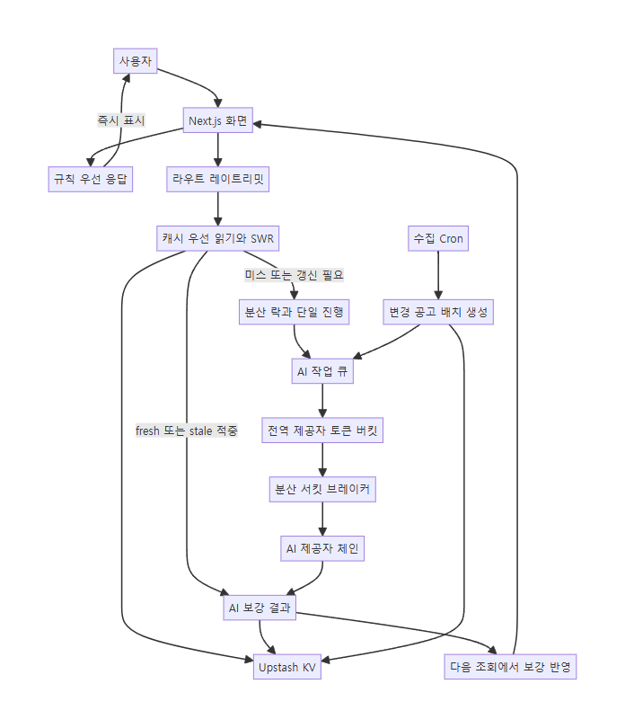
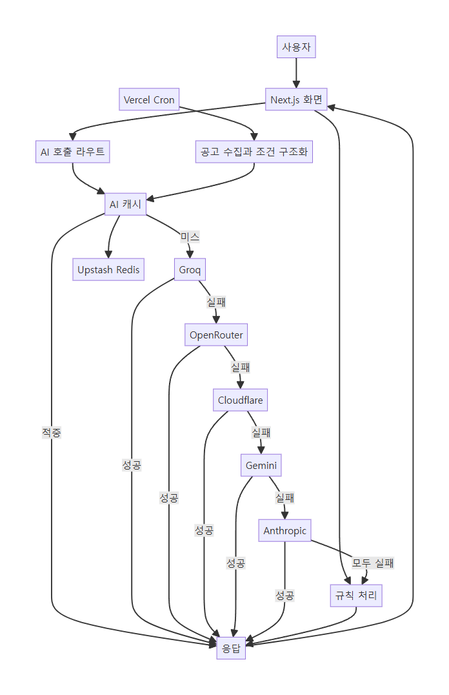
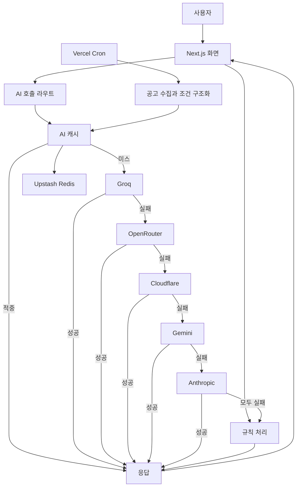
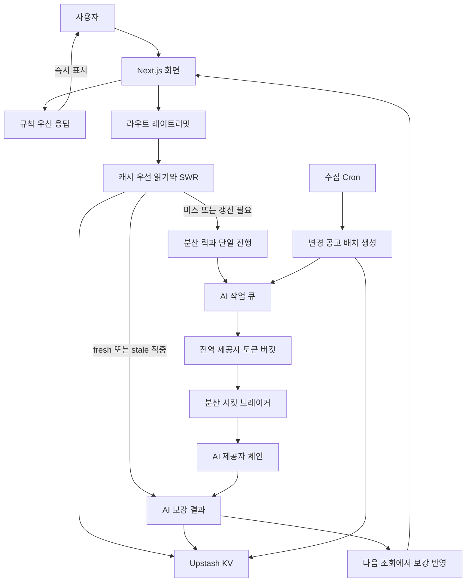
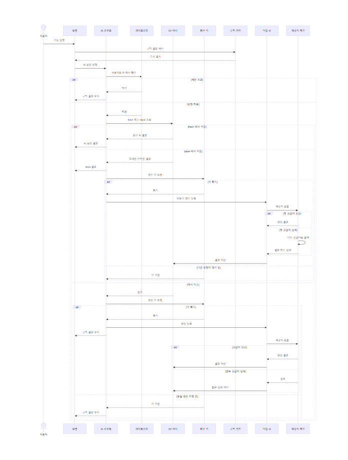
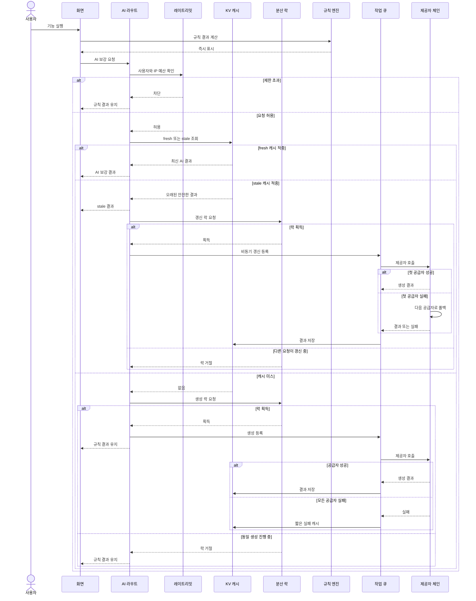
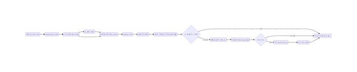
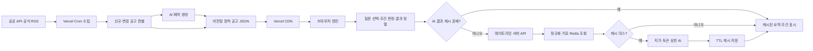

# My News AI 트래픽 대응 현황과 전환 설계

작성 2026-11-24 · 코드 조사·초안 Codex(`.ai-sync/tasks/20261123T160429-codex`, `.ai-sync/tasks/20261123T160632-codex`), 검토·편집 Claude. 앱 코드는 수정하지 않았다.

## 한눈에 보기

- **지금 대응**: 공고 조건·요약·장소는 Upstash 영구 캐시(365일), 제공자 5개 순차 폴백(각 4초), AI 실패 시 규칙 질문·규칙 초안, 공고 수집 cron에서 조건 구조화만 미리 생성.
- **부족한 점**: AI 라우트 5곳에 레이트리밋 없음, 질문·문장·신청 초안은 캐시 없이 매 요청 AI 호출, 동시 캐시 미스 중복 호출, 폴백 최악 20초, 쿨다운·캐시가 인스턴스별 메모리.
- **전환 방향**: AI 호출을 "사용자 수 비례"에서 "공고 수 비례"로. 수집 직후 배치 생성 → 정적 JSON·KV 캐시 우선 → 규칙 먼저 보여주고 AI는 비동기 보강 → 레이트리밋·전역 토큰 버킷·서킷 브레이커로 남은 실시간 호출 보호.



## 1. 요약

- My News는 공고 조건 구조화, 질문 생성·다듬기, 공고 요약, 장소 추출, 신청 초안 작성에 생성형 AI를 사용한다.
- 공급자는 Groq → OpenRouter → Cloudflare → Gemini → Anthropic 순서로 호출하며, 각 요청의 타임아웃은 4초이다.
- 조건 구조화·요약·장소 추출에는 Upstash Redis 기반 영구 캐시가 있으나, 질문·문장·신청 초안에는 영구 캐시와 요청 중복 방지가 없다.
- 공고 수집 Cron에서 조건 구조화를 미리 수행하지만, 질문·요약·신청 초안은 대부분 사용자 요청 시 생성한다.
- AI 라우트에는 사용자·IP별 레이트리밋이 없어 트래픽 급증 시 제공자 한도 소진, 캐시 스탬피드 및 긴 폴백 지연 위험이 있다.

## 2. AI 사용처

| 기능 | 호출 라우트·파일 | 입력 / 출력 | 호출 시점 | 실패 시 대체 |
|---|---|---|---|---|
| 공고 자격조건 구조화·분류 | `web/lib/ai/index.ts:29-40,70-103`, `web/lib/sources/index.ts:113-149`, `/api/cron/collect`의 `web/app/api/cron/collect/route.ts:17` | 자격요건 원문 → 나이·지역·소득·고용상태 등의 `Condition[]` | 공고 수집 배치에서 실행. 일반 화면 요청에서는 캐시된 결과만 즉시 반영하고 신규 분석은 백그라운드 실행 | 정규식 규칙 결과 사용. 규칙이 충분하면 AI를 호출하지 않음 |
| 다음 질문 및 선택지 생성 | `/api/next-question`, `web/app/api/next-question/route.ts:22-41` | 남은 후보의 필터 축·공고 표본·이전 답변 → 질문 1개와 선택지 | 탐색 단계마다 필요할 때 호출 (`web/app/play/page.tsx:352-383`) | 검증된 규칙 질문 또는 정보 이득 순위 1위 질문 사용 (`web/app/play/page.tsx:318-328`) |
| 추가 세분화 질문 생성 | `/api/refine-question`, `web/app/api/refine-question/route.ts:16-30` | 최대 240개 공고의 제목·요약·분야와 이전 답변 → 근거 구절을 포함한 질문·선택지 | 기본 질문이 부족하거나 결과에서 더 좁힐 때 호출 (`web/app/play/page.tsx:320-365`) | 공고 분포를 이용한 규칙 질문 `ruleRefinement` 사용 (`web/lib/ai/refinement-rules.ts:54-69`) |
| 기본 질문 문장 다듬기 | `/play/phrase`, `web/app/play/phrase/route.ts:6-13` | 질문의 `attr`, `op`, `value` → 격식체 질문 한 문장 | 질문이 표시될 때 호출 (`web/app/play/page.tsx:424`) | `defaultQuestionText` 기본 문장 사용 (`web/lib/ai/index.ts:105-116`) |
| 공고 카드 요약·신청 방법 요약 | `/api/summary`, `web/app/api/summary/route.ts:7-35`, `web/lib/ai/summary.ts:62-91` | 최대 5개 공고의 제목·기관·요약·자격·신청 방법 → 공고별 요약과 신청 행동 | 결과 화면에서 요청 (`web/app/result/page.tsx:60`) | 기존 공고 데이터가 그대로 유지되며 API는 캐시된 일부 결과 또는 `ai:false` 반환 |
| 신청 준비 요령·초안 | `/api/prep`, `web/app/api/prep/route.ts:16-45` | 선택 공고, 인터뷰 답, 사용자 시·도 → 준비 요령과 최대 3개 초안 | 신청 준비 페이지 진입 시 호출 (`web/app/prepare/page.tsx:21-40`) | 규칙 기반 체크리스트와 기본 초안을 먼저 표시 (`web/lib/prep/index.ts:30-53`) |
| 근무지·주택 위치 추출 | 직접 라우트가 아니라 공고 로딩 후처리, `web/lib/geo/extract.ts:67-93,96-135` | 공고 제목·기관·요약·자격요건 → 주소 또는 장소명 | 규칙과 캐시가 모두 실패한 공고를 백그라운드에서 최대 30건 처리 | 규칙 추출 결과 사용. 실패도 1일 캐시하고 장소 없이 계속 진행 |
| 매칭 이유 설명·질문 선택 | `web/lib/ai/index.ts:119-157` | 매칭 근거 또는 질문 후보·이전 답변 → 설명문 또는 질문 ID | 해당 함수 호출 시 실시간 생성 | 규칙 설명 또는 정보 이득 순위 질문 사용 |

## 3. 현재 대응

### 3.1 영구 캐시

AI 캐시 키는 `namespace:SHA-256(input)의 앞 24자리`이며 Redis에는 `ai:` 접두사가 추가된다. Redis 환경변수는 `UPSTASH_REDIS_REST_URL/TOKEN`을 우선하고 `KV_REST_API_URL/TOKEN`을 대체로 사용한다 (`web/lib/ai/cache.ts:13-24,72-78`).

저장 우선순위는 다음과 같다.

1. Upstash Redis REST
2. 로컬 개발 환경의 `.cache/ai-{namespace}.json`
3. 프로세스 메모리 `Map`

Vercel에서는 파일 캐시가 비활성화된다 (`web/lib/ai/cache.ts:44-50,84-92,95-123`).

| 네임스페이스 | 키 구성 | 성공 TTL | 실패·폴백 TTL | 근거 |
|---|---|---:|---:|---|
| `conditions` | `conditions-v2` + 자격요건 원문 | 365일 | 규칙 결과 1일 | `web/lib/ai/index.ts:40,70-100` |
| `summary` | `summary-v3-formal` + 공고 ID·제목·기관·요약·자격·신청방법 | 365일 | 생성 실패 표시 `false` 1일 | `web/lib/ai/summary.ts:7,51-59,62-88` |
| `place` | 프롬프트 버전과 공고 데이터로 만든 입력 | 365일 | 빈 위치 결과 1일 | `web/lib/geo/extract.ts:67-93` |

질문 생성, 질문 문장 다듬기, 신청 초안에는 영구 캐시가 없다. 요약 라우트의 `cachedSummaries`는 서버 프로세스의 메모리 `Map`만 먼저 확인하며 (`web/lib/ai/summary.ts:15-25`), 영구 캐시는 `summarizeOpportunities` 내부에서 조회한다.

### 3.2 제공자 폴백

호출 순서는 환경변수가 설정된 공급자만 포함하여 다음과 같이 고정된다 (`web/lib/ai/providers.ts:209-260`).

| 순서 | 공급자 | 기본 모델 | 요청 타임아웃 |
|---:|---|---|---:|
| 1 | Groq | `openai/gpt-oss-120b` | 4초 |
| 2 | OpenRouter | `meta-llama/llama-3.3-70b-instruct:free` | 4초 |
| 3 | Cloudflare Workers AI | `@cf/meta/llama-3.1-8b-instruct` | 4초 |
| 4 | Gemini | `gemini-3.5-flash-lite` | 4초 |
| 5 | Anthropic | `claude-haiku-5-5` | 4초 |

모델은 각각 환경변수로 덮어쓸 수 있다 (`web/lib/ai/providers.ts:120-140,181-185,216-254`). `ask()`에 전달되는 모델 인자는 현재 사용하지 않고 모든 호출을 동일한 `chat()` 체인으로 보낸다 (`web/lib/ai/index.ts:22-25`).

HTTP 402·429·5xx가 발생하면 해당 프로세스에서 공급자를 기본 10분간 건너뛴다. 429는 `Retry-After`가 있으면 그 값을 적용한다 (`web/lib/ai/providers.ts:25-39,47-65`). 성공할 때까지 공급자를 순차 호출하므로 모든 공급자가 타임아웃되면 이론상 약 20초까지 누적될 수 있다. 신청 초안은 별도로 전체 20초 제한을 두며 (`web/app/api/prep/route.ts:34`), 요약 라우트는 4초 후 응답만 포기한다 (`web/app/api/summary/route.ts:27-31`).

### 3.3 규칙 기반 폴백

- 조건 구조화는 정규식 규칙을 먼저 실행하며, 규칙이 3개 이상이거나 나이와 다른 속성을 함께 찾으면 AI를 호출하지 않는다 (`web/lib/ai/index.ts:80-100`, `web/lib/ai/rules.ts:36-80`).
- AI가 반환한 조건은 규칙이 찾지 못한 속성만 보완하고, 원문 근거와 현실 범위를 다시 검증한다 (`web/lib/sources/index.ts:80-107`).
- 기본 질문은 정보 이득으로 순위를 정한 규칙 질문을 유지하며 AI 실패 시 첫 질문을 사용한다 (`web/app/play/page.tsx:316-328`).
- 추가 세분화 질문은 미리 정의한 공고 분류 축 중 실제 후보를 둘 이상으로 나누는 축을 점수화한다 (`web/lib/ai/refinement-rules.ts:9-50,54-69`).
- 신청 준비 페이지는 AI 응답 전부터 규칙 기반 서류·절차·초안을 제공한다 (`web/lib/prep/index.ts:15-53`, `web/app/prepare/page.tsx:21-40`).

### 3.4 사전 생성

공고 수집 Cron은 매일 `00:30 UTC`, 즉 한국시간 `09:30`에 실행된다 (`web/vercel.json:2-5`). 수집 과정은 `waitAi: true`로 조건 구조화를 기다린 뒤 공고 풀을 저장한다 (`web/lib/server/pool.ts:204-222,262-263`). 소스별 기본 재수집 간격은 15분이지만 현재 Vercel Cron 자체는 하루 한 번이다 (`web/lib/server/pool.ts:12-15`, `web/vercel.json:2-5`).

현재 사전 생성되는 AI 산출물은 공고 자격조건 구조화와 수집 중 수행되는 위치·조건 보강이다. 다음 질문, 추가 질문, 공고 요약, 신청 초안의 배치 사전 생성 코드는 확인되지 않았다.

일반 공고 요청은 CDN에 `s-maxage=600`, `stale-while-revalidate=3600`을 적용한다 (`web/app/api/opportunities/route.ts:8-11`). 이는 공고 API 응답 캐시이며 AI 산출물별 SWR 구현은 아니다.

### 3.5 레이트리밋과 동시성 제어

AI 라우트 `/api/next-question`, `/api/refine-question`, `/api/summary`, `/api/prep`, `/play/phrase`에는 사용자·IP별 레이트리밋이 없다. `web/lib/server/security.ts`에도 토큰 해시 및 푸시 구독 검증만 있고 범용 레이트리밋은 없다 (`web/lib/server/security.ts:1-31`).

현재 확인되는 AI 부하 제어는 다음뿐이다.

- 공고 조건 보강: 신규 AI 호출 최대 15건, 동시 실행 2건 (`web/lib/sources/index.ts:32,110-148`)
- 장소 추출: 최대 30건, 동시 실행 2건 (`web/lib/geo/extract.ts:13-14,96-134`)
- 동일 서버 프로세스 안에서 조건 보강·장소 추출 중인 공고 ID를 `Set`으로 중복 방지 (`web/lib/sources/index.ts:110-121`, `web/lib/geo/extract.ts:109-131`)
- 공급자별 실패 통계와 쿨다운도 프로세스 메모리에만 저장 (`web/lib/ai/providers.ts:8-25,264-279`)

무료 한도의 정확한 RPM·TPM·일일 요청 수치는 코드에 없다. `AI_CONCURRENCY = 2`가 “무료 등급(Gemini) 분당 한도”를 위한 것이라는 주석만 있으므로 실제 제공자별 한도는 확인이 필요하다 (`web/lib/sources/index.ts:111`).

## 4. 트래픽 급증 시 부족한 점

| 심각도 | 부족한 점 | 영향과 코드 근거 |
|---|---|---|
| 상 | 공개 AI 라우트의 레이트리밋 부재 | 사용자가 질문을 반복하거나 자동 요청을 보내면 공급자 무료 한도와 유료 키 비용을 직접 소모한다. `/api/next-question`, `/api/refine-question`, `/api/summary`, `/api/prep`, `/play/phrase`에는 인증·IP 제한이 없다. |
| 상 | 캐시 미스 스탬피드 | `getCached`와 `setCached` 사이에 분산 락이 없다 (`web/lib/ai/cache.ts:72-123`). 같은 공고의 최초 요약·조건·장소 요청이 여러 인스턴스에 동시에 들어오면 같은 AI 호출이 중복된다. 파일 쓰기용 `locks`는 네임스페이스 단위 로컬 파일 직렬화일 뿐 AI 생성 락이 아니다 (`web/lib/ai/cache.ts:10-11,115-123`). |
| 상 | 질문·초안 요청의 무캐시 구조 | 다음 질문, 추가 질문, 문장 다듬기, 신청 초안은 동일 입력이어도 매번 AI를 호출한다 (`web/app/api/next-question/route.ts:37`, `web/app/api/refine-question/route.ts:25`, `web/app/api/prep/route.ts:34`, `web/app/play/phrase/route.ts:10`). |
| 상 | 무료 한도 수치와 공급자별 전역 예산 부재 | 코드에는 제공자별 RPM·TPM·일일 쿼터가 없다. 정확한 무료 한도는 확인 필요다. 동시성 2 제한도 수집·장소 작업에만 적용되고 사용자 라우트에는 적용되지 않는다 (`web/lib/sources/index.ts:110-148`). |
| 상 | 서버리스 인메모리 상태의 비공유 | 캐시, 공급자 쿨다운, 통계, `aiPending`, 장소 `pending`은 인스턴스별 메모리다. 인스턴스 확장·콜드 스타트 시 중복 호출과 장애 공급자 재호출이 발생한다 (`web/lib/ai/cache.ts:10`, `web/lib/ai/providers.ts:21-23`, `web/lib/sources/index.ts:110`). |
| 중 | 순차 폴백 타임아웃 누적 | 공급자당 4초이며 최대 5개를 순차 호출한다 (`web/lib/ai/providers.ts:49-52,257-260`). 질문 라우트에는 서버 측 전체 데드라인이 없어 최대 약 20초까지 지연될 수 있다. 클라이언트는 다음 질문 15초, 추가 질문 25초 후 중단한다 (`web/app/play/page.tsx:362,383`). |
| 중 | 응답 포기 후 작업 지속 가능성 | 요약 라우트의 `Promise.race`는 4초 후 응답만 중단하며 내부 AI Promise를 취소하지 않는다 (`web/app/api/summary/route.ts:27-31`). 요청이 몰리면 사용자에게 결과를 주지 못한 작업도 공급자 호출과 캐시 쓰기를 계속할 수 있다. |
| 중 | SWR 부재와 만료 즉시 미스 | AI 캐시는 만료된 값을 삭제하고 `null`을 반환한다 (`web/lib/ai/cache.ts:26-27,89-92`). 오래된 안전한 결과를 먼저 제공하면서 한 번만 갱신하는 stale-while-revalidate가 없다. |
| 중 | 공급자 서킷 상태가 분산되지 않음 | 402·429·5xx 쿨다운은 해당 인스턴스에만 적용된다 (`web/lib/ai/providers.ts:21-25,47-59`). 다른 인스턴스는 같은 장애 공급자를 계속 호출할 수 있다. |
| 중 | 배치 범위 부족 | Cron 수집 시 조건 구조화는 수행하지만, 공고 요약·대표 질문·신청 초안은 사전 생성하지 않는다 (`web/lib/server/pool.ts:217-222`, `web/lib/ai/summary.ts:62-91`). 인기 공고의 최초 트래픽이 실시간 AI 호출로 집중된다. |
| 중 | 비용 통제 단위 부재 | 공급자별 성공·실패 횟수만 메모리로 집계한다 (`web/lib/ai/providers.ts:264-273`). 토큰 수, 사용자별 사용량, 일일 예산, 비용 상한 및 강제 차단이 없다. |
| 하 | API 키 노출 위험 | 키는 서버 환경변수에서만 읽고 Authorization 헤더로 외부 공급자에 전송하므로 코드상 클라이언트 노출은 확인되지 않는다 (`web/lib/ai/providers.ts:79-95,120-140,216-254`). 다만 인증 없는 프록시성 AI 라우트가 키의 쿼터를 대신 소모하게 할 수 있다. |
| 하 | 상태 API의 운영 정보 노출 | `/api/ai-status`가 인증 없이 공급자별 성공·실패·쿨다운 시간을 반환한다 (`web/app/api/ai-status/route.ts:1-9`). 키 자체는 노출하지 않지만 공격자가 공급자 상태를 추정할 수 있다. |

## 5. 전환 설계

### 5.1 사전 배치 생성

`/api/cron/collect`에서 공고 수집과 조건 구조화가 끝난 직후 자주 쓰는 AI 산출물을 생성해 Upstash에 저장한다.

변경 위치:

- `web/lib/server/pool.ts`
  - `collectPool()`의 공고 저장 전후에 AI 사전 생성 단계를 추가한다.
  - 신규·변경 공고만 선별하여 조건 구조화, 장소, 요약을 생성한다.
- `web/lib/ai/summary.ts`
  - 기존 `summarizeOpportunities()`를 그대로 배치에서 재사용한다.
- `web/lib/ai/cache.ts`
  - 기존 `conditions`, `place`, `summary` 네임스페이스를 유지한다.
- `web/app/api/cron/collect/route.ts`
  - 배치 결과에 생성 건수·캐시 적중·실패 건수만 추가한다.
- `web/vercel.json`
  - 공고 수집 주기 변경이 필요할 때만 수정한다. 현재는 하루 한 번이므로 15분 수집 의도와 운영 Cron이 일치하는지 먼저 결정해야 한다.

대표 질문은 사용자 개인 답변 전체를 미리 만들 수 없으므로, 분야·공고 풀 버전·대표 후보 구간별 공통 질문을 사전 생성하는 방식으로 제한한다. 신청 초안은 개인정보와 인터뷰 답에 의존하므로 완성 초안 전체가 아니라 공고별 준비 요령·문서 골격까지만 사전 생성한다.

예상 효과:

- 인기 공고의 첫 화면에서 조건·장소·요약 AI 호출 제거
- 트래픽과 AI 사용량을 사용자 요청 수가 아니라 신규·변경 공고 수에 가깝게 제한
- 배치 실패가 사용자 요청 지연으로 직접 이어지는 비율 감소

### 5.2 캐시 우선 읽기, SWR, 단일 진행

`web/lib/ai/cache.ts`에 최소한의 공용 생성 헬퍼를 추가한다.

```ts
getOrGenerate(ns, key, {
  freshTtl,
  staleTtl,
  generate,
})
```

동작 원칙:

1. fresh 값이 있으면 즉시 반환
2. stale 값이 있으면 즉시 반환하고 갱신은 한 번만 시작
3. 값이 없으면 Upstash `SET NX PX` 락 획득자만 생성
4. 락을 못 얻은 요청은 짧게 재조회한 뒤 규칙 결과 반환
5. 락에는 반드시 짧은 만료시간을 둠

변경 위치:

- `web/lib/ai/cache.ts`: fresh/stale 메타데이터, Redis 분산 락, 인스턴스 내부 in-flight Promise Map
- `web/lib/ai/index.ts`: `structureConditions`를 `getOrGenerate`로 전환
- `web/lib/ai/summary.ts`: 요약 생성의 공고별 단일 진행 적용
- `web/lib/geo/extract.ts`: 장소 추출의 프로세스 로컬 `pending`을 분산 락으로 보완
- `web/app/api/next-question/route.ts`, `web/app/api/refine-question/route.ts`, `web/app/play/phrase/route.ts`: 프롬프트 버전과 정규화 입력을 키로 단기 캐시
- `web/app/api/prep/route.ts`: 공고 데이터와 익명화된 범주 답변의 해시를 키로 짧은 TTL 캐시

예상 효과:

- 동일 캐시 미스가 동시에 발생해도 AI 호출 1회로 축소
- 만료 시점의 응답 지연 제거
- 여러 Vercel 인스턴스 간 중복 호출 감소

### 5.3 규칙 우선 응답 후 AI 비동기 보강

현재 신청 준비는 이미 규칙 결과를 먼저 표시한다 (`web/app/prepare/page.tsx:27-40`). 같은 패턴을 질문과 요약에도 확대한다.

변경 위치:

- `web/app/play/page.tsx`
  - `rankQuestions()` 또는 `ruleRefinement()` 결과를 즉시 표시한다.
  - AI 결과가 제한 시간 안에 도착하고 현재 단계가 바뀌지 않았을 때만 문장·선택지를 교체한다.
- `web/app/result/page.tsx`
  - 기존 공고 요약을 즉시 표시하고 AI 요약은 캐시 적중일 때만 동기 반영한다.
  - 캐시 미스는 비동기 생성 요청 후 다음 조회에서 반영한다.
- `web/app/api/next-question/route.ts`, `web/app/api/refine-question/route.ts`
  - 캐시 미스 시 즉시 `202` 또는 `ai:false`를 반환하고 생성 작업은 큐로 넘긴다.
- `web/app/api/prep/route.ts`
  - 규칙 초안 응답을 서버에서도 명시적으로 유지하고 AI는 선택적 보강값만 반환한다.

예상 효과:

- 공급자 장애·한도 초과 시에도 핵심 탐색 흐름 유지
- 사용자 체감 응답시간을 AI 공급자 지연과 분리
- 폴백 체인 전체를 기다리는 요청 감소

### 5.4 큐, 레이트리밋, 서킷 브레이커

#### 사용자·IP별 레이트리밋

Upstash 토큰 버킷 또는 고정 윈도 카운터를 `web/lib/server/security.ts`에 추가한다.

최초 권장값은 실제 트래픽 측정 전 임시값이며, 아래 수치는 **추정**이다.

- 질문·문장 API: 사용자 또는 IP별 분당 10회
- 요약 API: 사용자 또는 IP별 분당 5회
- 신청 초안: 사용자 또는 IP별 분당 3회
- 요청 본문 해시가 같으면 제한량을 추가 차감하지 않고 기존 in-flight 또는 캐시 결과 사용

적용 위치:

- `web/app/api/next-question/route.ts`
- `web/app/api/refine-question/route.ts`
- `web/app/api/summary/route.ts`
- `web/app/api/prep/route.ts`
- `web/app/play/phrase/route.ts`
- 필요하면 `web/app/api/ai-status/route.ts`는 운영자 인증을 추가하거나 제거

#### 전역 제공자 토큰 버킷

`web/lib/ai/providers.ts`에서 공급자 호출 전에 Upstash에 저장된 공급자별 요청·토큰 예산을 확인한다. 실제 한도 수치는 공급자 대시보드와 약관 확인 후 설정해야 한다.

- 키 예시: `ai:quota:{provider}:{minute}`
- 예상 토큰 수는 입력 길이와 `maxTokens`로 보수적으로 산정
- 예산이 부족하면 네트워크 호출 없이 다음 공급자로 이동
- 일일 비용 상한 도달 시 무료 규칙 응답만 허용

#### 큐

사용자 응답과 분리할 수 있는 작업만 큐에 넣는다.

- 공고 조건 구조화
- 장소 추출
- 공고 요약
- 대표 질문 사전 생성
- 공고별 신청 준비 골격 생성

신청 초안의 개인화 부분과 현재 대화의 다음 질문은 실시간성이 필요하므로, 짧은 대기열 또는 규칙 응답 후 비동기 보강으로 처리한다.

#### 분산 서킷 브레이커

`web/lib/ai/providers.ts`의 메모리 `stats`를 Upstash 상태로 보완한다.

- 연속 실패 또는 최근 실패율 임계치 초과 시 회로 개방
- 402·429는 `Retry-After` 또는 설정된 쿨다운까지 차단
- 쿨다운 뒤 한 요청만 half-open 시험
- 성공 시 회로 복구
- 서버리스 인스턴스 전체가 동일 상태 공유

예상 효과:

- 특정 제공자 장애가 전체 응답 지연으로 확대되는 것을 방지
- 무료 한도와 유료 비용을 전역에서 통제
- 사용자 요청 폭증이 공급자 API에 그대로 전달되지 않음

### 5.5 단계별 도입 순서

| 단계 | 시기 | 변경 | 예상 효과 |
|---:|---|---|---|
| 1 | 해커톤 마감 내 | `web/lib/server/security.ts`에 간단한 Upstash IP 레이트리밋 추가 후 5개 AI 라우트에 적용 | 반복 호출과 단순 남용 즉시 차단 |
| 2 | 해커톤 마감 내 | `web/lib/ai/cache.ts`에 인스턴스 내부 in-flight Promise Map과 Redis `SET NX` 락 추가 | 동일 입력 스탬피드 억제 |
| 3 | 해커톤 마감 내 | 질문·문장·신청 초안에 프롬프트 버전 기반 단기 캐시 추가 | 사용자 반복 조작 시 AI 호출 감소 |
| 4 | 해커톤 마감 내 | 질문·결과 화면을 규칙 우선 표시로 통일하고 AI 제한시간을 짧게 설정 | 공급자 장애 중에도 즉시 사용 가능 |
| 5 | 해커톤 마감 내 | `/api/cron/collect` 직후 변경 공고의 요약·장소를 사전 생성 | 인기 공고 첫 요청 지연 감소 |
| 6 | 이후 | AI 캐시에 stale 구간과 백그라운드 갱신 추가 | 만료 시점 지연과 미스 폭증 제거 |
| 7 | 이후 | 전역 제공자 토큰 버킷·일일 예산·분산 서킷 브레이커 도입 | 제공자 한도·비용·장애를 중앙 통제 |
| 8 | 이후 | 내구성 있는 큐와 작업 상태·재시도·관측 지표 구축 | 대규모 배치와 실시간 트래픽 분리 |
| 9 | 이후 | 실제 RPM·TPM·비용 측정 후 공급자 순서와 모델 재조정 | 지연·품질·비용 최적화 |

## 6. 다이어그램

### 6.1 현재 요청 흐름



<details><summary>mermaid 원본</summary>



</details>

### 6.2 전환 후 아키텍처


<details><summary>mermaid 원본</summary>



</details>

### 6.3 요청 처리 시퀀스



<details><summary>mermaid 원본</summary>



</details>

## 7. 대량 트래픽 비용 최소화

> 검토 메모(Claude): 아래 "`/api/next-question`, `/play/phrase` 호출 제거"는 사용자가 요구한 AI 기반 동적 질문과 충돌한다. 제거가 아니라 **규칙 질문을 즉시 표시하고, AI 질문은 캐시 적중이거나 제한 시간 안에 도착할 때만 교체**하는 방식(5.3)으로 적용한다.

### 전제

- 분석 기준일: 2026-11-24
- 코드 변경 없이 현재 구현을 읽고 산정했다.
- 무료 한도는 변경 가능하므로 공식 문서의 현재 수치에도 `확인 필요(2026-11-24)`를 붙였다.
- Tavily는 사용 한도 초과(HTTP 432)로 조회하지 못해 Exa로 공식 문서를 확인했다.

### 7.1 현재 구성의 비용 발생 지점

| 항목 | 현재 사용 방식 근거 파일:라인 | 트래픽 비례 여부 | 무료 한도 |
|---|---|---|---|
| Vercel CDN·전송량 | `/api/opportunities`가 JSON을 반환하고 10분 CDN 캐시 적용 (`web/app/api/opportunities/route.ts:7-11`) | 캐시된 요청·응답 바이트는 사용자 수에 비례 | Hobby: CDN 요청 월 100만 건, 전송 100GB, Origin 전송 10GB — 모두 **확인 필요(2026-11-24)** ([공식 문서](https://vercel.com/docs/plans/hobby)) |
| Vercel Functions | 공고·AI·알림·상태 API가 서버 함수로 실행. AI 라우트는 Node 런타임 (`web/app/api/summary/route.ts:5-7`, `web/app/api/refine-question/route.ts:5-16`) | 사용자 API 호출 수에 비례 | Hobby: 함수 호출 월 100만 건, Active CPU 4시간, 메모리 360GB-hours — **확인 필요(2026-11-24)** ([공식 문서](https://vercel.com/docs/functions/usage-and-pricing)) |
| 공고 목록 Redis 읽기 | 목록 요청마다 메타 1회와 출처별 데이터 GET 실행 (`web/lib/server/pool.ts:114-129,156-177`) | CDN 미스·함수 실행 수와 출처/청크 수에 비례 | Upstash Free: 월 50만 명령, 250MB, 10GB — **확인 필요(2026-11-24)** ([공식 문서](https://upstash.com/docs/redis/overall/billing)) |
| 공고 수집 Redis 쓰기 | 변경 출처별 SET/DEL 후 메타 SET (`web/lib/server/pool.ts:132-153,180-199`) | 사용자 수와 무관, 수집 주기·출처·청크 수에 비례 | 위 Upstash 한도와 합산 |
| 알림·Watch Redis | 등록 시 SET+SADD, 삭제 시 DEL+SREM, 전체 조사 시 SMEMBERS 후 사용자별 GET/SET (`web/lib/server/store.ts:44-83`, `web/lib/server/scan.ts:70-75`) | Watch 사용자 수에 비례 | 위 Upstash 한도와 합산 |
| AI 캐시 Redis | 캐시 조회마다 GET, 생성 후 SET+EX (`web/lib/ai/cache.ts:72-108`) | AI 요청 수 및 캐시 미스에 비례 | 위 Upstash 한도와 합산 |
| 실시간 AI 질문 | 플레이 중 `/api/next-question`, `/api/refine-question`, `/play/phrase` 호출 (`web/app/play/page.tsx:362-424`) | 사용자·질문 단계 수에 직접 비례 | 제공자·모델·계정별 상이. 운영 콘솔 확인 필요(2026-11-24) |
| AI 요약·조건·주소 추출 | 요약 캐시 미스 시 AI 생성 (`web/lib/ai/summary.ts:63-87`), 조건 구조화 (`web/lib/ai/index.ts:74-99`), 주소 추출 (`web/lib/geo/extract.ts:68-92`) | 현재는 사용자 요청 또는 신규 공고 수에 비례 가능 | Gemini 한도는 프로젝트·모델별 동적 — **확인 필요(2026-11-24)** ([공식 문서](https://ai.google.dev/gemini-api/docs/rate-limits)) |
| 무료 LLM 폴백 | Groq → OpenRouter → Cloudflare → Gemini → Anthropic 순으로 시도 (`web/lib/ai/providers.ts:209-254`) | 선행 제공자 실패 시 요청 1건이 여러 외부 호출로 증폭 | Groq·Cloudflare·Gemini는 계정 콘솔 확인 필요. OpenRouter 무료 모델은 일 50회 또는 크레딧 조건 충족 시 1,000회 — **확인 필요(2026-11-24)** ([공식 문서](https://openrouter.ai/docs/api_reference/limits)) |
| 공공·민간 API | 11개 어댑터를 등록하고 출처별 fetch 실행 (`web/lib/sources/index.ts:26-28,50-70`) | 정상적으로 Cron 배치만 실행하면 사용자 수와 무관 | API별 승인 한도·페이지 크기가 다르므로 각 활용신청 콘솔에서 확인 필요(2026-11-24) |
| 웹 검색 API | 실시간 경로에서 Tavily/Exa 검색 가능 (`web/lib/sources/index.ts:166-172`, `web/lib/sources/websearch.ts:129-170`) | 캐시되지 않은 사용자 조회에 비례할 수 있음 | Tavily·Exa 요금제별 확인 필요(2026-11-24) |
| 지오코딩 | 공고 수집 시 주소 좌표 조회, 사용자 검색에는 Kakao/Nominatim 호출 가능 (`web/lib/sources/index.ts:199-202`, `web/app/api/geocode/route.ts:10-26`) | 수집용은 공고 수, 검색용은 사용자 수에 비례 | Kakao 쿼터 확인 필요(2026-11-24). Nominatim 공용 서버는 대량 운영 백엔드로 사용하지 않는 편이 안전 |
| Cron | 공고 수집과 알림 조사를 매일 1회씩 실행 (`web/vercel.json:2-4`) | 기본 호출은 고정, 알림 조사는 Watch 수에 비례 | Vercel 플랜별 Cron 제약 확인 필요(2026-11-24) |

### 7.2 비용 최소화 설계

#### 정적 생성·ISR·CDN

- 앱 셸과 안내 페이지는 정적 생성한다.
- Cron 수집 완료 후 `opportunities.<version>.json` 또는 도메인별 정적 JSON을 한 번 생성한다.
- 브라우저는 `/api/opportunities` 함수 대신 CDN 정적 JSON을 직접 읽는다.
- 파일명에 콘텐츠 해시나 수집 시각을 넣고 `Cache-Control: public, max-age=0, s-maxage=86400, stale-while-revalidate=604800`을 적용한다.
- 최신 버전을 가리키는 작은 manifest만 짧게 캐시한다. 공고 본문 JSON은 immutable로 배포하면 캐시 무효화 요청도 줄어든다.
- 현재 10분 캐시는 (`route.ts:11`) 인기 트래픽에는 유효하지만, 캐시 갱신 때마다 함수와 Redis를 다시 거친다. Cron 이후 정적 JSON으로 바꾸면 일반 조회에서 함수·Redis·공공 API 호출을 모두 제거할 수 있다.

#### 브라우저에서 엔진 판정

- 공고 JSON과 판정 규칙을 브라우저로 내려받고, 질문 선택·후보 필터링·조건 일치·결과 정렬을 클라이언트에서 실행한다.
- 현재의 `/api/next-question` 및 `/play/phrase` 호출은 결정적 규칙과 기본 문장으로 대체한다.
- 서버에는 API 키가 필요한 생성형 기능과 알림 저장만 남긴다.
- 이 변경으로 핵심 탐색 흐름의 함수 호출은 사용자당 여러 회에서 0회가 된다.

#### AI 캐시 키 정규화

AI 입력 원문 전체를 그대로 해시하기 전에 다음을 정규화한다.

- Unicode NFC, 앞뒤 공백 제거, 연속 공백·개행 축약
- 객체 키 순서 고정과 배열 정렬
- 추적 파라미터를 제거한 URL
- 날짜·수집시각처럼 출력에 영향을 주지 않는 필드 제외
- `promptVersion + providerIndependentTask + normalizedInput` 형태로 키 생성
- 공고 ID만 쓰지 말고, 실제 의미가 바뀌었는지를 나타내는 콘텐츠 해시 사용

동일 공고의 공백·필드 순서 차이가 별도 캐시 항목이 되는 것을 막아 AI 호출과 Redis 저장량을 함께 줄인다.

#### AI 배치 생성

- Cron 수집 후 신규 또는 내용 해시가 변경된 공고만 추린다.
- 조건 구조화·요약·주소 추출을 공고 여러 건씩 묶어 생성한다.
- 생성 결과를 정적 JSON에 포함시킨다.
- 사용자 요청 시 AI를 호출하지 않고, 배치 결과가 없는 공고만 규칙 기반 문구를 표시한다.
- 호출량 기준이 `DAU × 질문 수`에서 `신규·변경 공고 수 ÷ 배치 크기`로 바뀐다.
- 무료 제공자 폴백은 배치 작업에서만 사용하고, 실패하면 다음 Cron으로 이월한다. 사용자 요청 안에서 여러 제공자를 연쇄 호출하지 않는다.

#### Redis 명령 수 절감

- `readPool()`의 출처별 GET을 `MGET` 또는 REST 파이프라인 한 번으로 합친다.
- Watch 등록의 `SET+SADD`, 삭제의 `DEL+SREM`도 파이프라인으로 왕복을 줄인다.
- 단, Upstash는 파이프라인 내부 각 Redis 명령도 과금 명령으로 계산하므로 네트워크 왕복은 줄지만 명령 과금 자체가 1건이 되는 것은 아니다.
- `SMEMBERS → 사용자별 GET`은 ID를 일정 크기로 나눠 `MGET`한다.
- 공고 풀은 가능하면 압축된 단일 또는 도메인별 객체로 유지하고, 매 사용자 요청에서 읽지 않는다.
- Watch, 음성 캐시, 실패 캐시에 TTL을 설정하고 만료된 ID를 인덱스에서 정리한다.
- 읽기 전용 공고 목록은 Redis가 아니라 CDN 정적 JSON을 원본으로 사용한다.

#### Edge와 Node 함수 선택

- 정적 목록과 앱 셸은 CDN에서 제공해 런타임 자체를 사용하지 않는다.
- AI 호출, Cron 수집, Redis 배치, Web Push는 기존처럼 Node 함수에 둔다. Node 호환성과 긴 작업 제어가 중요하며 Redis 지역과 가까운 리전을 선택한다.
- Edge는 작은 인증·레이트리밋 등 짧고 CPU 사용이 적으며 전 세계 지연시간이 중요한 요청에만 제한한다.
- Edge 전환 자체가 자동 비용 절감을 보장하지 않는다. Vercel도 현재 Node 런타임을 성능·신뢰성 측면에서 권장하며 두 런타임 모두 Fluid Compute 과금 대상이다 ([공식 문서](https://vercel.com/docs/functions/runtimes/edge)).

#### 남용 차단과 유료 전환

- IP와 익명 세션 기준 토큰 버킷 레이트리밋을 AI·지오코딩·Watch 쓰기 API에 적용한다.
- 요청 본문 크기, 사용자당 동시 요청, 일일 AI 생성 횟수를 제한한다.
- 동일 캐시 키의 동시 미스에는 분산 락이나 single-flight를 적용한다.
- 유료 전환 시에는 작은 Flash/Lite/Haiku급 모델부터 비교하고, 작업별 `max_tokens`를 고정한다.
- 질문 문장 80~150, 구조화 500~1,024, 배치 요약은 공고당 출력 토큰 상한을 둔다.
- 무료 모델 뒤에 유료 모델을 자동 폴백으로 연결하지 말고, 일일 예산·중단 임계값·알림을 설정한다.

### 7.3 트래픽 규모별 예상 호출 수

다음은 비용 최소화 설계 적용 후의 **추정**이다.

가정:

- DAU당 앱 방문 1회, 정적 공고 JSON 1회 요청
- 앱 셸·JS·이미지 요청은 제외하고 핵심 데이터 경로만 계산
- 정적 JSON CDN 적중률 99%, Origin 미스율 1%
- 엔진 판정은 전부 브라우저에서 실행
- 신규·변경 공고 200건/일, AI 배치 20건/호출, 공고당 3개 작업을 한 응답에서 생성
- AI 배치 실패 재시도·제공자 폴백은 제외
- 외부 공공 API의 Cron 1회 실측 요청 수를 `A`로 표기
- Watch 등록·Push 알림 트래픽은 사용자 선택률에 따라 크게 달라 별도 용량 산정 필요

| DAU | CDN 정적 JSON 요청/일 | Origin 요청/일 | 브라우저 엔진 서버 호출 | AI 호출/일 | Redis 공고 조회 명령 | 공공 API 호출/일 |
|---:|---:|---:|---:|---:|---:|---:|
| 1천 | 약 1,000 | 약 10 | 0 | 약 10 | 0 | `A` |
| 1만 | 약 10,000 | 약 100 | 0 | 약 10 | 0 | `A` |
| 10만 | 약 100,000 | 약 1,000 | 0 | 약 10 | 0 | `A` |

비교용 현재 구조 **추정**: 사용자당 공고 API 2회, AI 질문·문장·요약 5회가 발생한다고 가정하면 1천/1만/10만 DAU에서 함수 호출은 각각 약 7천/7만/70만 회/일, AI 요청은 약 5천/5만/50만 회/일까지 증가할 수 있다. 실제값은 Vercel 로그에서 라우트별 호출 수를 측정해 교체해야 한다.

### 7.4 적용 순서

#### 해커톤 마감 내 적용 가능

1. 공고 API의 `s-maxage`를 수집 주기에 맞춰 늘리고 `stale-while-revalidate`를 유지한다.
2. 질문 선택·조건 판정·정렬을 기존 브라우저 엔진으로 통일하고 `/api/next-question`, `/play/phrase` 호출을 제거한다.
3. AI 캐시 입력의 공백·객체 키·배열 순서를 정규화한다.
4. AI 라우트에 IP·세션별 레이트리밋과 출력 토큰 상한을 둔다.
5. 무료 AI 실패 시 규칙 기반 결과를 즉시 사용하고 사용자 요청 내 다중 제공자 연쇄 호출을 제한한다.
6. Redis 다중 읽기를 `MGET`/파이프라인으로 묶는다.

#### 이후 단계

1. Cron 완료 후 버전이 붙은 정적 공고 JSON과 manifest를 생성한다.
2. 신규·변경 공고만 AI 배치 처리하고 결과를 정적 JSON에 병합한다.
3. 공고 조회 경로에서 Redis와 서버 함수를 완전히 제거한다.
4. Watch를 샤딩된 `MGET` 배치로 조사하고 Push 전송 큐를 분리한다.
5. Vercel·Upstash·AI 제공자별 예산 알림과 자동 차단선을 운영한다.
6. 실제 로그로 DAU당 데이터 요청, 캐시 적중률, AI 미스율, 공고당 Redis 명령 수를 측정해 용량표를 갱신한다.

### 7.5 비용 최소화 아키텍처



<details><summary>mermaid 원본</summary>



</details>

## 8. 무료 AI 선택지 조사 (2026-11-24 기준, 공식 문서 조사)

"무제한 무료"로 쓸 수 있는 서버용 API는 찾지 못했다. 대신 서버 무료 한도를 여러 제공자로 나눠 쓰고, 캐시·배치로 호출 수 자체를 줄이고, 최후에는 브라우저에서 사용자 측 무료 AI를 부르는 3단 구성이 현실적이다.

| 구분 | 제공자 | 무료 한도 | 쓸 곳 |
|---|---|---|---|
| 서버 | Groq gpt-oss-120b | 분당 30회, 일 1,000회 | 1순위 (현재 기본) |
| 서버 | Gemini Flash-Lite | 분당 10회, 일 500회 | 배치 생성 |
| 서버 | OpenRouter :free 모델 | 분당 20회, 일 50회 (10달러 1회 충전 시 일 1,000회) | 보조 |
| 서버 | Cloudflare Workers AI | 일 1만 neurons | 보조·짧은 문장 |
| 브라우저 | Puter.js | 사용자 계정이 비용 부담, 사실상 무제한 (사용자 로그인 필요) | 서버 체인 소진 시 선택 폴백 |
| 브라우저 | Pollinations 익명 API | IP당 45초 1건, GPT-OSS 20B | 최후 폴백 (질문 문장 다듬기 정도) |
| 제외 | Chrome 내장 AI | 한국어 미지원 | 사용 안 함 |
| 제외 | Cerebras·Mistral 무료 API, GitHub Models | 무료 API 없음 또는 종료 보도 | 사용 안 함 |

서버 무료 합계는 대략 하루 2,500회 남짓이다. 그래서 핵심은 제공자를 더 붙이는 것보다 **호출을 사용자 수가 아니라 공고 수에 비례하게 바꾸는 것**(5.1 배치 생성, 7장 정적 JSON)이다. 이렇게 하면 DAU가 10만이어도 AI 호출은 하루 수십 회 수준으로 유지된다(7.3 추정표). 브라우저 폴백은 IP·사용자별로 한도가 따로 잡히므로 트래픽이 몰려도 서버 한도를 쓰지 않는 장점이 있지만, 사용자 답변이 외부로 나가므로 개인정보 필드를 빼고 질문 문장 다듬기처럼 공고 데이터만 쓰는 작업에 한정한다.

출처: 각 제공자 공식 문서(조사: 코디네이터, 2026-11-24). 수치는 바뀔 수 있으므로 적용 전 콘솔에서 재확인한다.
